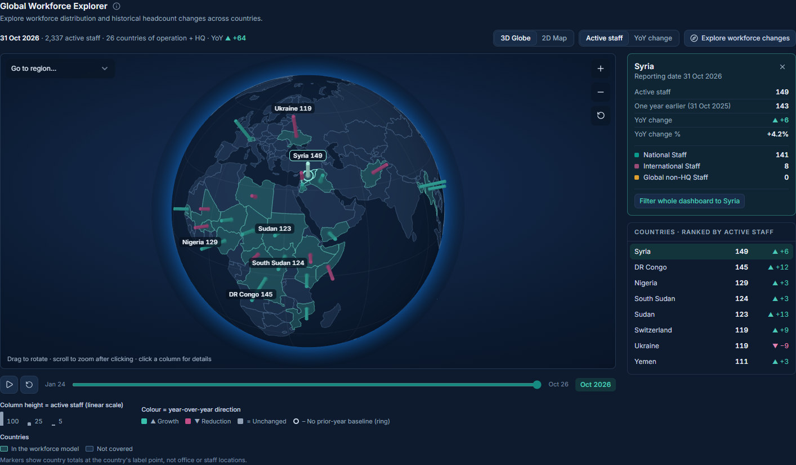
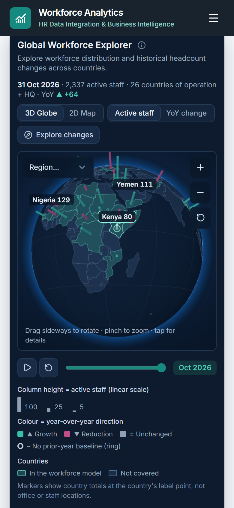
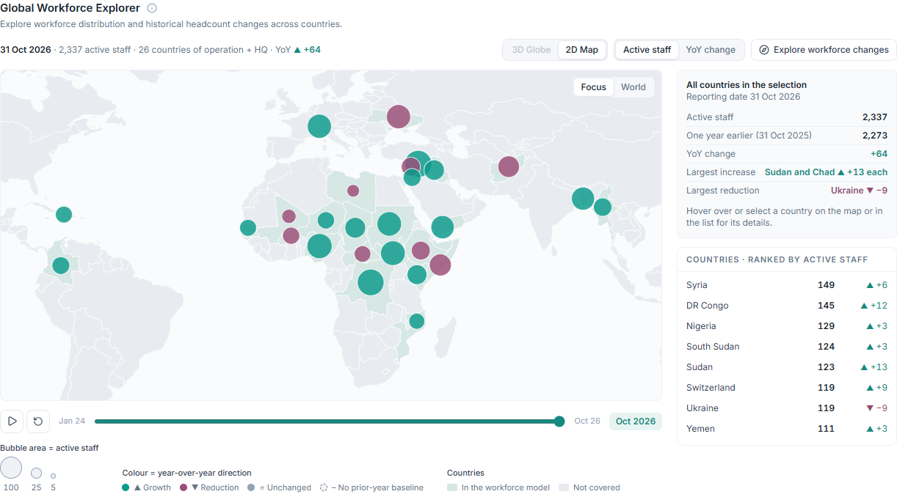
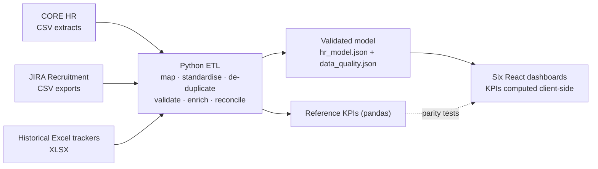

# Workforce Analytics

**HR Data Integration & Business Intelligence.** An interactive workforce analytics platform that consolidates three HR sources
into a validated model and decision-ready indicators.

**▶ Live website: https://leobobadilha.github.io/workforce-analytics-portfolio/**

By **Leonardo Bobadilha** · [GitHub](https://github.com/LeoBobadilha) · [LinkedIn](https://www.linkedin.com/in/leonardobobadilha/)

> **Independent portfolio project with fully synthetic data.** Every record is generated by a seeded simulation and describes no real
> person, organisation or workforce statistic.


---

## The reporting problem

Organisations that operate across several countries rarely hold workforce data in one place. Master data and contracts sit in an
HRIS (here *CORE HR*), recruitment runs through a ticketing tool (*JIRA*), and history lives in country-level Excel trackers. The
sources overlap during system migrations, use different formats and disagree on counts. This project rebuilds that situation end to
end and turns it into a reliable analytics product:

- **Data integration**: three sources with different schemas, formats, migration windows and overlaps merged into one model, with no double counting.
- **Data quality**: 34 automated rules, enrichment, imputation, exclusions and reconciliation against historical snapshot trackers.
- **KPI development**: explicit numerators, denominators and reporting dates for every indicator, cross-checked by two independent implementations.
- **Dashboard development**: six dashboards with global filters, year-over-year comparisons, record-level tables and built-in documentation.
- **Automated testing and CI/CD**: data, KPI-parity and browser tests run before every deployment.

The workforce model covers four mutually exclusive staff categories (National, International, Global non-HQ and HQ), recruitment
and vacancy management, retention and turnover, performance appraisals, contract expiries, short-term surge deployments and
nationality diversity.

## Dashboards

| # | Dashboard | Highlights |
|---|---|---|
| 1 | **Workforce Overview** | Active staff, YoY growth, staff categories, gender balance, countries of operation, monthly evolution, **Global Workforce Explorer** (3D globe and 2D map), National vs International split by country, growth by country, sortable country table |
| 2 | **Global Workforce Profile** | Global (HQ + Global non-HQ) vs International evolution, current vs previous-year comparison by country and category, grades, contract types, average-age evolution |
| 3 | **Diversity & Mobility** | Global South / North share and history, diversity by grade, a GN/GS toggle that filters the whole profile (gender, contract types, nationality ranking, geography, expatriation), surges by National vs International staff |
| 4 | **Recruitment & Vacancies** | Open vacancies, vacancy rate, due-vacancy rate, time to hire vs planned duration (by country and grade), New vs Replacement, internal vs external, closure outcomes, funnel, open-vacancy register |
| 5 | **Retention & Development** | 12-month retention (headline + evolution), annualised turnover, voluntary vs involuntary exits by reason, turnover by country and staff type, appraisal completion by department |
| 6 | **Contracts & Data Quality** | Active and expiring contracts (4-month window), International Staff expiry %, durations by grade, Grades 3 & 4 analysis, searchable contract register, data quality by source, validation summary, lineage and reconciliation |
| + | **Methodology & KPIs** | Pipeline, sources, category definitions, every KPI formula and the known limitations, inside the app |

| | |
|---|---|
|  |  |
|  |  |
|  |  |

Full-page captures of each dashboard are in [`docs/screenshots/full/`](docs/screenshots/full/). Interaction evidence:
[tooltip](docs/screenshots/tooltip.png) · [GN/GS toggle](docs/screenshots/diversity-gs-toggle.png) ·
[empty state](docs/screenshots/empty-state.png) · [mobile layout](docs/screenshots/mobile-contracts.png) ·
[map country selected](docs/screenshots/explorer-selected.png) · [globe country selected](docs/screenshots/globe-selected.png) ·
[guided exploration](docs/screenshots/globe-tour.png).

## Global Workforce Explorer

A geographic view on the Workforce Overview: where the workforce is, and how each country's headcount has changed
(in the year to October 2026: growth in Sudan, Chad and DR Congo, reductions in Ukraine and Mali). It offers two
views of the same figures, switchable at any time without losing the selected month, country or mode: an
interactive **3D globe** and the **2D map**.



### 3D globe

- **A real WebGL globe** (Three.js): the simplified Natural Earth boundaries are drawn once into the sphere's texture,
  with line meshes for borders. Countries in the workforce model are tinted, others stay neutral, and a light
  atmosphere marks the horizon. No satellite imagery, tiles, API keys or external services.
- **Columns** stand at each country's Natural Earth label point. They show a country total, not an office or staff
  location. Height is linear in the value, on a scale fixed across the selected period: active headcount ÷ the
  largest country headcount (*Active staff*), or |YoY change| ÷ the largest |change| (*YoY change*). Colour is
  the YoY direction (teal growth, burgundy reduction, grey unchanged), with ▲ ▼ = in every label and list. A ring
  marks countries with no prior-year baseline. Columns are thin (about 0.6°) and at most 0.27 globe radii tall, so
  neighbours such as Lebanon, Syria and Jordan stay separate. Markers on the far side of the planet are hidden and
  cannot be selected. A selected country is outlined and the other columns recede; hovering outlines a country
  lightly. Labels go to the selected, hovered and largest countries and never cover the on-globe controls.
- **Interaction**: drag to rotate, pinch or scroll to zoom, the + / − / reset buttons, region shortcuts derived from
  the model's regions, and arrow keys, + / − and 0 when the globe has keyboard focus. The scroll wheel zooms only
  after the globe has been clicked; until then it scrolls the page. On phones, a sideways drag rotates and a vertical
  drag scrolls the page as usual. Click or tap a column or country to pin its details. Selecting a country anywhere
  (globe, list, dashboard filter or guided exploration) turns it into view, centred slightly to its south so its
  column is seen at an angle rather than end-on. The camera never moves on its own while you read the panel.
- **Explore workforce changes**: an optional guided sequence of the three largest increases and the three largest
  reductions for the selected month and filters, ranked from the model. Each stop turns
  the globe to the country and shows its verified figures. You can pause, skip or exit at any time. It reports
  headcount changes only: no causes are implied and no movement arcs are drawn, because the data has no transfer
  records.
- **One ranking rule** for the YoY list, the summary panel and the tour: larger change first, then larger headcount,
  then name. Ties are stated, never resolved silently: the summary reads *Largest increase: Sudan and Chad ▲ +13
  each* (longer ties: *A, B and 3 others*, with the full list in its accessible label), and the tour labels them
  *joint*.



### 2D map



- Bubble area is proportional to the value; colour and glyphs follow the same YoY rules, with a dashed outline when
  there is no baseline. Focus and World extents. The 2D map remains the accessible, low-power alternative, and the
  default where WebGL is missing or software-only, or on low-end devices.

### Both views

- **Monthly timeline**: a slider (and optional play / pause / restart) moves through any month in the global period.
  It is local to the explorer, so the dashboard's reporting date does not change. Playback is off when the system
  requests reduced motion.
- **Country details**: hover for a tooltip. Pin a country to see headcount, the prior-year value, the YoY change
  (and % when the earlier headcount is above zero) and the four staff categories, which sum to the total. Applying
  a country to the whole dashboard is a separate, labelled button. The ranked list offers the same selection by
  keyboard or touch.
- **Filters**: the global period, country and staff-category filters apply; a country filter selects that country.
- **Linked to the model**: both views read one month × country × category headcount cube, built in a single pass over
  the same contract records as every KPI. Tests check every cell against the canonical active-contract logic, so the
  explorer total always equals *Total Active Staff*. Countries join the boundaries by ISO3 code.

### Performance and fallbacks

| | Before the globe | With the globe |
|---|---|---|
| Main JavaScript (gzipped) | 320.9 KB | 321.7 KB (+0.8 KB: view choice, WebGL check and Methodology text) |
| Explorer code / boundaries, loaded near the section | 25 KB / 42 KB | 28 KB / 42 KB |
| 3D globe code (Three.js + scene), loaded only for the 3D view | — | 142 KB |
| First dashboard content, laptop (median, 10 interleaved runs) | 775 ms | 749 ms |
| First dashboard content, phone profile, 4× CPU throttle (median, 9 interleaved runs) | 2.87 s | 3.12 s (ranges overlap: 2.4–4.5 s vs 2.7–3.8 s) |
| 3D globe ready after scrolling to it (laptop / phone profile) | — | 1.1 s / 1.6 s |
| Camera flight (laptop / phone profile) | — | 61 frames/s, 0.5 ms / 2.9 ms CPU per frame |
| Timeline step in 3D (laptop / phone profile) | 2D map: 31 ms / 125–180 ms | 31 ms / 51 ms |
| Frames drawn while idle · draw calls · textures | — | 0 · 8 · 1 |

The phone profile emulates a slower CPU on a desktop GPU, so it does not measure a phone's GPU.

The presentation refinements (shorter and thinner columns, focus framing, selection and hover emphasis, compact
phone layout) were measured against the first globe release (`258a2fb`) in alternating runs. Globe readiness, camera
frame rate (60–61 frames/s), timeline steps (median 31 ms on the laptop profile), idle rendering (none) and draw
calls (8) are unchanged. On the phone profile, first dashboard content was a median 0.2 s slower over 12 pairs.
The main bundle is unchanged apart from a file name and one class name, and the same build served twice differed
by up to 0.2 s, so this is within run-to-run variation on this machine.

- **Lazy loading**: Three.js is never in the main bundle. It loads only when the 3D view is shown, after the section
  approaches the viewport; other pages never load it.
- **On-demand rendering**: frames are drawn only while the camera, a flight or a height transition moves, and
  rendering pauses when the section is off-screen or the tab is hidden. Device pixel ratio is capped (1.75; 1.5 on
  touch devices), and the texture is 2048 × 1024 px (1024 × 512 on touch devices).
- **Fixed scene**: markers are instanced meshes with one slot per model country, so timeline, mode and filter
  changes rewrite 27 instances and never recreate meshes, textures or boundaries.
- **Cleanup and recovery**: all GPU resources are disposed when the page is left. If the browser drops the graphics
  context, a message offers the 2D map, and the globe rebuilds when the context returns.
- **Reduced motion**: no playback, no camera animation (views jump), and guided exploration advances only on request.

## Key features

- **Global filters that really recompute**: period (presets or custom month range), country and staff category. Every KPI, chart and table
  is recalculated from record-level data; filters persist across pages and can be cleared in one click.
- **Explicit reporting logic**: stocks on the reporting date, flows within the period, comparisons with the same date one year earlier; the
  active period and reporting date are always visible.
- **Explainable KPIs**: each card and chart has an ⓘ tooltip with its formula, and a Methodology page documents them all.
- **Detailed tooltips**, year-over-year deltas coloured by whether up is good, sparklines, and selective direct labels.
- **Interactive tables** with sorting, search, status filters and pagination (country summary, open vacancies, contract register, validation rules).
- **Handled edge cases**: empty states for impossible filter combinations, "n/a" where a KPI does not apply, and no prior-year baseline when history is missing.
- **Responsive layout** (desktop → mobile drawer navigation), accessible focus states and ARIA labels.
- **Consistent visual system**: a teal / burgundy / slate palette. The categorical chart palette was validated for colour-vision
  deficiency (adjacent-pair ΔE ≥ 8) and each entity keeps a fixed colour across all pages.

## Technology

| Layer | Stack |
|---|---|
| Front end | React 19 · TypeScript · Vite · Tailwind CSS 4 · Apache ECharts 6 (SVG renderer, geo component) · Three.js (3D globe, lazily loaded) · Lucide icons · React Router (hash routing) |
| Data | Python 3 · pandas · NumPy · openpyxl, with synthetic CSV / XLSX sources and a compact JSON model; Natural Earth 1:110m country boundaries |
| Quality | pytest (data integrity & KPI logic) · Vitest (TypeScript vs pandas KPI parity) · Playwright (end-to-end interaction checks & screenshots) |
| Delivery | GitHub Actions (tests → build → deploy) · GitHub Pages (static, no backend, no external APIs at runtime) |

## Relation to BI platforms

This is a custom web application, not a Power BI or Tableau report: it contains no Power Query M scripts, DAX measures or
published semantic model. A web build means the demonstration opens from a link, without an account on a BI platform. The
concepts transfer to a BI-platform implementation as architectural parallels rather than one-to-one equivalents (Power BI shown
as an example):

| In this project | Comparable Power BI concept |
|---|---|
| Python ETL (`pipeline/build_model.py`): column mapping, standardisation, de-duplication, imputation | Data preparation often implemented in Power Query or dataflows |
| Record-level entities (employees, contracts, separations, vacancies, surges, appraisals) with shared keys | The analytical foundation a semantic model would be built on (fact and dimension tables) |
| TypeScript KPI logic (`web/src/lib/metrics.ts`) with a reporting date and a period | Reporting logic that could be translated into DAX measures over a date table |
| Global period, country and staff-category filters | Report slicers applied across pages |
| GN/GS toggle filtering one page | A slicer or field parameter instead of duplicated pages |

## Data architecture



### Synthetic sources

| Source | Content | Simulated imperfections |
|---|---|---|
| **CORE HR** (`data/raw/core_hr`) | Employees, contracts, separations, performance appraisals. International, Global and HQ staff for the full history; National Staff from the Jan 2025 go-live | Missing nationality / birth date / gender, impossible birth dates, country spelling variants, inconsistent contract-type casing, fixed-term contracts without end date |
| **JIRA** (`data/raw/jira`) | Recruitment requests 2025+ (status, resolution, due date, funnel, `time_to_done_hours`) and surge requests 2026+ | Duplicate rows from overlapping exports, resolution before creation, missing due dates, country variants |
| **Historical Excel trackers** (`data/raw/excel_trackers`) | National staff tracker 2023–24, vacancy tracker 2022–24, surge tracker 2023–25, monthly national headcount snapshots, expatriation tracker | Different column names and date formats (`dd/mm/yyyy`, `Grade 3`), outcome label variants, manual-entry conflicts with CORE, missing monthly submissions, off-by-one counts |

Volumes: ~4,100 employees, ~12,200 contracts, ~1,900 separations, ~2,900 vacancies, ~350 surge requests, ~7,600 appraisals across 26 countries
plus headquarters (Jan 2023 – Oct 2026; the dashboards report Jan 2024 – Oct 2026, with 2023 providing the year-over-year baseline).
Details are in [`docs/DATA_MODEL.md`](docs/DATA_MODEL.md).

## KPI documentation (summary)

| KPI | Definition |
|---|---|
| Active staff | Contracts with start ≤ reporting date ≤ end; one contract per person, so no double counting |
| Headcount growth YoY | Headcount(D) ÷ Headcount(D − 12 months) − 1 |
| Global South share | GS ÷ (GS + GN) nationals in the international workforce (HQ + Global non-HQ + International) |
| Vacancy rate | Open vacancies(D) ÷ [Headcount(D) + Open vacancies(D)] |
| Due vacancy rate | Open vacancies past their due date ÷ the same total positions |
| Time to hire | Closed − opened date, averaged over vacancies filled in the period |
| Recruitment success rate | Filled ÷ (filled + cancelled) vacancies closed in the period |
| Retention rate | Staff active 12 months before D still employed on D ÷ that cohort |
| Annual turnover | Separations in period ÷ average month-end headcount × 12 ÷ months |
| Appraisal completion | Eligible staff (≥ 6 months' service) appraised in the last 12 months ÷ eligible staff |
| Contracts expiring in 4 months | Active contracts with planned end within the next four months |

Full definitions: [`docs/KPI_DEFINITIONS.md`](docs/KPI_DEFINITIONS.md), also available on the in-app *Methodology & KPIs* page.

## Validation & reconciliation results

Figures from the committed pipeline run (`web/public/data/data_quality.json`):

| Result | Value |
|---|---|
| Validation rules | 34 |
| Issues detected / resolved automatically | 1,673 / 1,597 (standardised, imputed, enriched or excluded); 76 remain as warnings: 67 missing nationality, birth date or gender, 4 implausible birth dates, 5 vacancies resolved before creation |
| Overlapping records merged across sources | 4,060 (planned migration overlaps, not counted as issues) |
| National headcount snapshots vs model | 600 of 615 country-month values match; 15 differ and the contract-level model is retained |
| Expatriation tracker vs model | 864 of 972 country-month values match exactly. 75 of the 108 differences fall within the number of staff in that country with no recorded nationality, which is consistent with missing nationality. The remaining 33 are flagged (rule REC-03) |

Discrepancies are reported, not hidden: the *Contracts & Data Quality* page lists every rule with its status, and sample differences per tracker.

## Testing

| Check | What it proves |
|---|---|
| `pytest` (36 tests) | Unique keys, valid reference values, no overlapping contracts, referential integrity (contracts, hires, surges, appraisals), date ordering, a monotonic funnel, and **exact reproduction of the simulated monthly headcount by category** after merging the sources; KPI formulas checked on a hand-calculated toy dataset; the world map is reproducible from its source, within its size budget and covers every model country |
| `vitest` (38 tests) | The TypeScript KPI engine matches the pandas reference across 6 filter scenarios (29 KPIs each), with one contract per employee at every month-end; the map's headcount cube equals the active-contract logic for every month × country × category, its totals and YoY values match the KPIs, and every model country maps to a boundary containing its bubble anchor; the 3D globe's coordinates, horizon and picking geometry, column heights and values (reconciled with the KPIs under filters), the no-baseline state, the guided-exploration ranking, ties in the summary, list and tour (positive, negative, longer ties, missing baselines, filtered selections), the focus framing and the default-view rule |
| `scripts/e2e.mjs` (71 checks) | Real-browser navigation of all pages, filters changing KPIs, persistence, clear filters, empty states, GN/GS toggle partition, table search / sort / status filter, chart tooltips, no mobile overflow, no runtime errors; for the map: lazy loading, totals vs KPIs, timeline steps and latency, modes, selection and reset, global filters, playback and cleanup, reduced motion, and layout at 1920, 1366, 768 and 390 px; for the 3D globe: Three.js loaded only for the 3D view, default view by WebGL capability, totals and labels vs the list, camera focus on selection, hover, click and empty-space picking, drag, wheel-vs-page-scroll, zoom / reset / regions, state kept across 3D ↔ 2D, filters, timeline latency with no scene rebuild and no idle rendering, guided exploration, context loss and recovery, disposal after navigation, touch rotate vs page scroll and tap, reduced motion, no-WebGL fallback, the summary panel's tie wording, globe keyboard control, the compact phone layout, and the four layouts |

All three suites run automatically in GitHub Actions on every push to `main`, and the site is deployed only if they pass.
`scripts/perf.mjs` measures load timings, long tasks, explorer loading and timeline latency on laptop and throttled mobile profiles, and with `--view=3d` the globe's frame rate, idle frames, heap, draw calls and cleanup.

## Run locally

Requirements: Python 3.11+ and Node.js 20+.

```bash
# 1. Data: generate the synthetic sources, consolidate and validate them, compute reference KPIs
pip install -r requirements.txt
python pipeline/generate_sources.py   # -> data/raw/          (CORE HR, JIRA, Excel trackers)
python pipeline/build_model.py        # -> data/processed/, web/public/data/
python pipeline/kpis.py               # -> data/processed/reference_kpis.json
python pipeline/build_geo.py          # -> web/public/geo/world-110m.json (Natural Earth, simplified)
python -m pytest -q

# 2. Web app
cd web
npm install
npm test                              # KPI parity tests
npm run dev                           # http://localhost:5173
npm run build                         # static site in web/dist
```

The generated data is committed, so the web app runs without step 1. Browser checks (local Chrome required):
`npm run e2e` while the dev server runs. The simulation is seeded, so the pipeline reproduces the committed data exactly.

## Repository structure

```
├── pipeline/                 Python: config, simulation, ETL & validation, reference KPIs
├── data/
│   ├── raw/                  Simulated sources: core_hr/, jira/, excel_trackers/
│   ├── external/             Natural Earth 1:110m country boundaries (public domain)
│   └── processed/            Consolidated model (CSV), data_quality_report.json, reference_kpis.json
├── tests/                    pytest suite (data integrity + KPI logic)
├── web/
│   ├── public/data/          hr_model.json, data_quality.json (served to the app)
│   ├── public/geo/           world-110m.json (simplified map for the Global Workforce Explorer)
│   ├── src/lib/metrics.ts    KPI engine (+ metrics.test.ts parity tests)
│   ├── src/lib/geo.ts        Map headcount cube (+ geo.test.ts reconciliation tests)
│   ├── src/pages/            The six dashboards + methodology
│   ├── src/charts/           ECharts wrapper, shared chart builders and palette
│   └── scripts/              Playwright e2e checks, performance measurements and screenshot capture
├── docs/                     KPI definitions, data model, screenshots
└── .github/workflows/        Test → build → deploy to GitHub Pages
```

## Development

I worked with AI coding assistance (Claude Code) during development, including implementation and interface design, while
guiding the requirements, reviewing results and refining the reporting logic.

## Known limitations

- **Synthetic scope.** The pipeline has been run only on simulated data. KPI definitions are reasonable reporting conventions, not
  an organisation's agreed policy; a production deployment would confirm them with HR stakeholders and test them against real extracts.
- **Expatriation** is a proxy (nationality ≠ country of assignment), not an official expatriation status. Missing nationality is
  one identified source of mismatch with the historical tracker; see the reconciliation results above.
- **Global North / South** uses an illustrative list (high-income OECD-DAC countries) that should be replaced by the
  organisation's reference list.
- **Staff categories and grades** (G1–G7) are a modelling choice for a multi-country workforce, not the classification of any real organisation.
- **3D globe on real phones**: no physical Android or iOS device was available for testing. Performance was
  measured with CPU throttling and touch emulation on a desktop GPU, which does not show phone GPU speed, heat or
  sustained throttling. Low-end devices and software-only WebGL default to the 2D map, and both views are always
  available. On the globe, the tightest clusters (Lebanon, Syria, Jordan) still need zooming in or the ranked list.

Map data: [Natural Earth](https://www.naturalearthdata.com/) 1:110m Admin 0 – Countries (public domain). Country
boundaries are shown for orientation only.

## Disclaimer

This is an independent portfolio demonstration. All data is fictional and generated by a seeded simulation; no real organisation's
data, systems or confidential information were used, and no figure should be read as a statistic about a real organisation or its staff.
