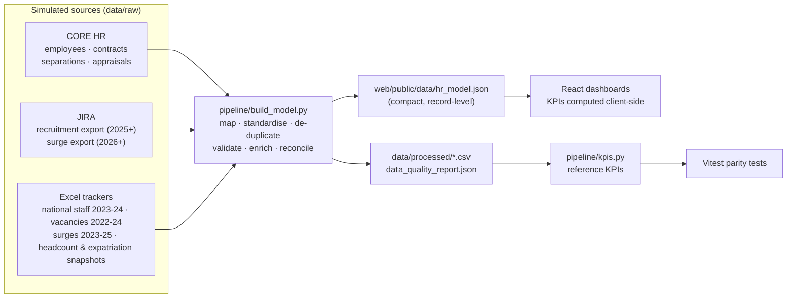

# Data Model & Source Integration

All data is **synthetic**. A seeded, event-driven workforce simulation (January 2023 – October 2026) produces one
ground truth, which is then split into three simulated enterprise sources with realistic imperfections. The pipeline
consolidates them back into a single validated model, and a test proves that the consolidated model reproduces the
simulated month-end headcount **exactly** (no duplication, no loss).

## Simulation (pipeline/generate_sources.py)

Monthly loop over 26 countries of operation plus headquarters (Switzerland) and three regional hubs:

1. **Renewal decisions** are taken about two months before each contract's planned end: renew (possibly with promotion)
   or separate (non-renewal, end of funding, retirement). Planned separations open a replacement vacancy in advance.
2. **Unplanned separations** (resignation, dismissal) follow monthly hazards per staff category; replacements open during notice.
3. **Workforce plan**: each country × category cell follows a target trajectory (growth in Sudan, Chad and Lebanon,
   reduction in Ukraine and Mali, seasonal national staffing). The gap opens *New Position* vacancies.
4. **Vacancies** close after a log-normal time to fill (longer for higher grades and hard-to-staff contexts; improving over time)
   with an outcome: National Recruitment, External Recruitment, Internal Mobility (a real employee moves, which can trigger a
   chained replacement) or Cancelled Position. Hires create employees and contracts; former staff can be rehired.
5. **Surges** (normal flow + crisis spikes) are filled by active National or International staff from other country offices.
6. **Appraisals**: annual cycles (December–March) and end-of-probation reviews, with department-level completion rates.

## Entities (data/processed)

| Entity | Key | Main fields | Source(s) |
|---|---|---|---|
| employees | `employee_id` | gender, birth_date, nationality, nationality_group, first/latest hire date | CORE HR + Excel national staff tracker |
| contracts | `contract_id` | employee_id, start/end/planned_end, contract_type, staff_category, country, grade, department, position, start/end reason | CORE HR + Excel national staff tracker |
| separations | (`employee_id`, `exit_date`) | exit_type, exit_reason, category, country, grade | CORE HR + Excel tracker |
| vacancies | `vacancy_id` | country, category, grade, opening type, opened/due/closed dates, outcome, candidate type, hired employee, funnel counts, `dq_valid` | JIRA (2025+) + Excel vacancy tracker (≤ 2024) |
| surges | `surge_id` | requesting country, request date, status, deployed employee & category, home country, deployment dates | Excel surge tracker (≤ 2025) + JIRA (2026) |
| appraisals | (`employee_id`, `appraisal_date`) | appraisal_type | CORE HR |

## Integration rules

| Topic | Rule |
|---|---|
| Source precedence | CORE HR > JIRA > Excel. Overlapping records are merged, never double counted. |
| National staff migration | National staff moved from Excel into CORE in January 2025; staff and contracts spanning the go-live appear in both sources and are de-duplicated by ID (EMP-04, CTR-03). |
| Vacancy migration | Vacancies still open at JIRA go-live were migrated with a legacy reference; the Excel row is dropped in favour of JIRA (VAC-02). |
| Enrichment | Missing CORE attributes (nationality, birth date, gender) are filled from the Excel tracker when available (EMP-03). |
| Standardisation | Country spellings (`DRC`, `South-Sudan`, `Syrian Arab Republic`…), grade formats (`Grade 3` → `G3`), contract types and outcome labels mapped to controlled vocabularies. |
| Imputation | Fixed-term contracts without a planned end are imputed from their duration (CTR-05); recruitment requests without a due date get the standard planned duration (VAC-09). |
| Exclusions | Implausible birth dates (EMP-05) are excluded from age metrics; vacancies resolved before creation (VAC-05) are excluded from recruitment metrics. |
| Reconciliation | Monthly national headcount snapshots and the expatriation tracker are compared with the contract-level model (REC-01..03). Expatriation differences that fall within the number of staff with no recorded nationality are treated as explainable rather than counted as breaks; missing nationality is one identified source of mismatch, not the only one. |

## Geographic data

`pipeline/build_geo.py` reduces Natural Earth 1:110m Admin 0 – Countries v5.1.2 (public domain, vendored in
`data/external/`) to `web/public/geo/world-110m.json` (146 KB, 42 KB gzipped): ISO3, name and label point per
country, coordinates rounded to 0.1°, Antarctica removed. Countries are linked to the workforce model by ISO3
(`countries[].iso3` in `hr_model.json`). Natural Earth uses `-99` for a few features: France and Norway take
`ISO_A3_EH`; Somaliland is merged into Somalia, matching ISO 3166-1. All 27 model countries are present; a test
checks that each one's label point (the bubble anchor) lies inside its own boundary.

The explorer aggregates headcount in the browser: one pass over contracts builds a month × country × category
cube (46 months × 27 countries × 4 categories, about 5,000 cells), so timeline and filter changes are array lookups.
Vitest checks every cell against the canonical `activeAt` logic.

## Web model encoding

`hr_model.json` is column-oriented: each table has `columns`, `dicts` (dictionary encoding for categorical fields)
and `rows`; dates are integer days since 1970-01-01. `web/src/data/decode.ts` restores typed records.
